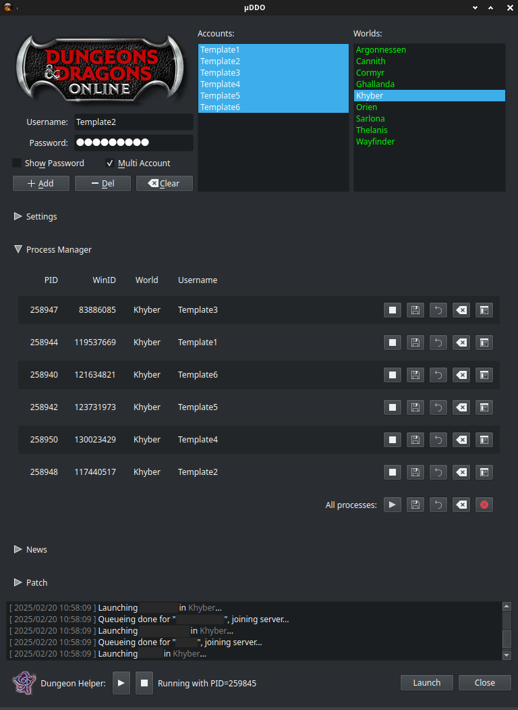

# μDDO

## Overview

A Linux launcher for the game Dungeons & Dragons Online, using Python and Qt6. Based on the now (unsupported?) PyLotRO launcher.

## Features
Currently implemented features:
 - launching the game and managing multiple (no upper limit) accounts at once
 - manages all processes/instances launched, including terminate, kill, restart
 - basic X window management of game windows: save position and border status and restores them
   - no Wayland support and no plans for supporting it
 - basic [Dungeon Helper](https://dungeonhelper.com/) integration (must be installed separately)
 - basic [Macro'ing](docs/Macros.md) capabilities, see docs for details on capabilities. Requires [Dungeon Helper](https://dungeonhelper.com/) with Milvian plugin

## TODO
  - replace ps calls by cTop module
  - make Milvian check the path from Dungeon Helper instead of a hard-coded path 
  - save border/borderless state (currently forces borderless)
  - fix several minor bugs with aProcessItem and their mismatching state with cOrb
  - allow detection of orphaned Dungeon Helper processes
  - simplify attaching/deattaching cConsole to most (all?) classes
  - remove lingering xdotool stuff
  - add window audio muting options
  - update README's screenshot
  - implement the patching capabilities
    - the first patching (when you install the game) doesn't seem to be working, but subsequent patches seem to be fine
  - migrate the game launcher from os.system to subprocess
    - currently it doesn't start but also doesn't show any specific error
  - implement news display
  - use keyring to store passwords instead of plain text format
  - test the launcher with Wine (currently tested with Steam Proton)
  - add cmd line option for verbosity
  - finalize DungeonHelper support
    - maybe add support for downloading/installing DungeonHelper.exe?
    - currently only one instance of Dungeon Helper can be managed, because tDHPIDWatcher 
    only looks processes containing DungeonHelper.exe and takes the PID of first thing
    it finds. This means that killing one of them kills all of them.

## License

This is licensed under GPL-3 license. See https://www.gnu.org/licenses/ for details.

## About "Lord of the Rings Online" Support

I removed the support to LotRO simply because I could not test it. The added complexity should be small, if anyone is interested in expanding the app for LoTRO too.

## About Windows and/or MacOS Support

I couldn't care less about Windows and/or MacOS (i.e. reciprocity). You are welcome to do the porting/testing/maintaining for other platforms, but please notice that you'll be bound to the GPL-3 license.

## Links:
- https://www.ddo.com
- https://github.com/Lynx3d/pylotro
- http://sny.name/LOTRO/