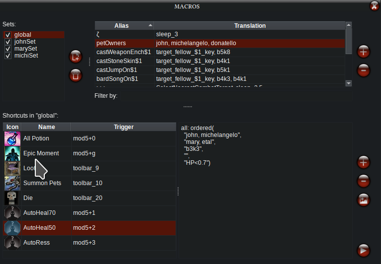
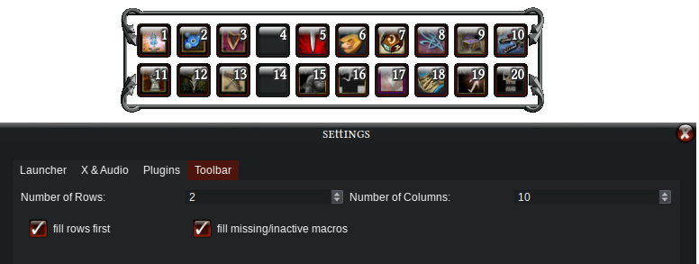
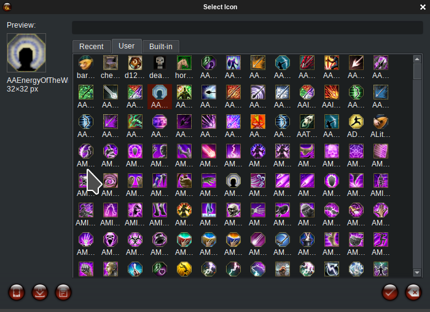

# Macros

**μDDO** together with **DungeonHelper+Milvian** plugin enable the configuration of macros and macro sets. They are **very** flexible but as we all know, with great power comes great income tax (only until a certain point, then it drops to zero).

All macros are tied to JSON files stored by default in `${HOME}/.config/muDDO/macros`. μDDO provides a full GUI to manage and edit them anyways.

>**⚠️ Do not modify files externally while μDDO is running**. It will not detect the changes (incredible that I even have to say this...)

This is the nomenclature used:

  - **macro sets**: all macros are grouped into "sets", which can be active or inactive. You must have at least one macro sets. See [Macro Sets](#macro-sets) subsection next for details.
  - **alias**: allows you to define keywords to substitute, either as a shortcut for something longer, or as a mini-function. A bit advanced, see the [Aliases](#aliases) subsection further down this document.
  - **macro panel**:
    - **icon**: only plays a role for toolbar triggers (see later). Otherwise, it is a decoration
    - **name**: only plays a role for toolbar triggers (see later). Otherwise, it is annotation
    - **trigger**: the trigger can be a keyboard shortcut, a toolbar position or a menu position
      - **shortcut**: a key press to execute this macro (see subsection below)        
      - **toolbar_X**: use this keyword where X is a number (the sky is the limit). Check the [Toolbar](#toolbar) subsection later
      - **menu_X**: not yet implemented 
      - **none**: useful for debugging/testing. This can only be triggered by clicking the "play" button at the bottom right of the macros panel
    - **macro scripts**: the larger edit to the right of the image displays the scripts of the selected macro. Detailed in the next section

Notice that there is a "Play" button at the bottom right corner of the macros panel (**Ctrl+Enter** works too). You can press it at any time to fire the currently selected macro - either for testing or if you're some sort of maniac.

Items in the macros and aliases tables can be reordered by drag-and-drop (sets can't, though).

### Shortcuts
Shortcuts must have the following syntax: `<modifier1>+<modifier2>+...+<key>`. Examples: ctrl+a, shift+alt+f2, or mod5+pageup, etc

  - `<key>` is anything from `/usr/include/X11/keysymdef.h` without the `XK_` prefix
  - you can also use xev command to see the actual name of the key, they match almost 1:1
  - valid `<modifier>` are : `shift`, `ctrl`, `alt`, `super`, `win`, `meta`, as well as `mod1` to `mod5`.
    - there is no distinction between left/right modifiers
    - CapsLock has been disabled as a modifier
    - technically even mouse buttons can be modifiers. I have disabled that (I think...)
    - test extensively your keyboard's behaviour
  - do not use spaces, do not use quotes
  - multiple macros may have **the same shortcut**. Feature, not a bug. See what happens in the [Consolidation](#consolidation) subsection

>**⚠️ There is no validation mechanism**. Nonsense shortcuts just cause nonsense behaviour. 

>**⚠️ Keyboard shortcuts are globally grabbed**. You can assign any key combination for triggering macros, but the keys get "swallowed" by the Macros Daemon. Don't assign stuff like "Esc" or "Shift" to a macro! You have been warned!

## Macro Sets
---------------------------------
A set is a JSON file in `${HOME}/.config/muDDO/macros`, with `.macro` extension. Create sets by pressing the "+" button, and then edit its name in-place in the list. This will rename the file to `${HOME}/.config/muDDO/macros/<macro name>.macro`, so don't use strange characters.

Example:

  *A player has two characters, John and Michelangelo. John is the main character, Michelangelo is a support bard who can also heal a bit. The player then creates 4 macro sets: johnCore, michiCore, michiHeal and michiDPS. The player then configures the core abilities for John and Michelangelo in their "core" sets.
  As for Michelangelo, the player sets ctrl+h to a healing spell in the michiHeal set, and to michiDPS he sets it to Greater Shout. The can then "toggle" the behaviour by switching one set on or off. The player may also leave both active at the same time; Michelangelo will perform BOTH ACTIONS, one after another (see [Consolidation](#consolidation) section later).*

You can toggle sets on/off by ticking the checkbox next to their names. Both Active and Inactive sets can be editted in the GUI, but only Active sets are parsed and executed by Milvian. 

To view and edit a macro set, select it from the list (i.e. highlight it, nothing to do with the checkbox).

## Macro Basic Body
---------------------------------
The main macro body is interpreted as a collection of **scripts** separated by semicolons:

`<script1>; <script2>; <script3>;`

The last ";" is optional. It can also be a single script, in which case no ";" is necessary at all. Each script subdivided as

`<actor1>, ..., <actorN>: <action1>, ..., <actionM>`

Each `<actor>` is a character currently hooked to the framework via Milvian Bridge. The list must be comma-separated. It will make a lot of sense to use the *meta actors* too, most importantly, "`all`"; see [Meta Actors](#meta-actors-and-targets) subsection later on. The `<actions>` are the actual commands to be executed, also comma-separated. Everything is case-insensitive. There are A LOT of possible actions, I'll go over the basic ones now and some advanced ones afterwards. You may press **Ctrl+S** to save your changes.

| Action | Syntax | Description |
|---|---|---|
| **InputAction** | `ActionName` | Mimics game input. Case-insensitive. [Full list](http://sdk.dungeonhelper.com/4.3.4/InputActions_8Generated_8cs.html). Example: `John, Mary: SelectNextCombatTarget, SHORTCUT_BAR5_KEY1` |
| **bXkY** | `bXkY` | Shorthand for `SHORTCUT_BARX_KEYY` (X = bar, Y = key). By far the most common action. |
| **tpmX** | `tpmX` | Shorthand for `TARGET_FELLOW_X_KEY` |
| **tppX** | `tppX` | Shorthand for `TARGET_FELLOW_PET_X_KEY` |
| **NamedAction** | `Spell Name` | Name of any skill, spell, feat, item, etc. Milvian resolves it at runtime. Must be slotted to a shortcut bar. No quotes, commas, or colons — e.g. write `Restoration Mass` not `"Restoration, Mass"`. Mix freely with InputActions: `mary: Bless, Chant, b3k2, Smite Evil` |
| **select(\*)** | `select(name)` | Selects first object matching `name`. No-op if none found. |
| **sleep(\*)** | `sleep(1.5)` | Waits N seconds (float). `sleep_N` also works but is deprecated. |
| **chat(\*)** | `chat(text)` | Types `text` in the chat box and sends. e.g. `all: chat(/death)` |
| **strategy(\*)** | `strategy(...)` | See [Strategy](strategy.md) for details. |
| **enterPortal** | `enterPortal` | Enters the currently selected quest portal. ⚠️ WIP |
| **closeExplorerJournal** | `closeExplorerJournal` | Closes the Explorer Journal popup. ⚠️ WIP/buggy |
| **ordered(\*)** | `ordered(...)` | Priority-based actor/target pairing. See section below. |
| **macro(\*)** | `macro(name)` | ⚠️ TODO. Will trigger a macro by name or shortcut. |

> **InputAction vs NamedAction:** InputActions target specific hotbar slots and allow different characters to execute complementary actions simultaneously. NamedActions resolve by name so all characters execute the same spell. InputActions also support braces expansion (see Aliases section).

> **⚠️ There is no validation mechanism**. Nonsense macros just cause nonsense behaviour. 

### Advanced Action - ordered(*)
This is an advanced command with several moving parts. It allows to define a priority list of possible actors (e.g. healers) and a priority for targets (e.g. who to keep alive). Syntax:

`<actor1>, ..., <actorN>: ordered("<actor1>, ..., <actorN>", "<target1>, ..., <targetN>", "<action1>, ..., <actionM>", "<actor_filter1>, ..., <actor_filterN>", "<target_filter1>, ..., <target_filterN>")`

The first set of "actors" is redundant but kept for the sake of my own sanity. Just use "all" meta actor (gets replaced by all active players anyway). This command will do the following in this order:

  - create an ordered list of the `<actor>` passed
  - exclude from this list any actor not meeting ALL of the `<actor_filter>`
  - create an ordered list of the `<target>` passed
  - exclude from this list any target not meeting ALL of the `<target_filter>`
  - pair each `<actor>` with a `<target>` according to the ordered lists
  - if not enough actors: excess targets get discarded. If not enough targets: excess actors get discarded
  - finally, each remaining `<actor>` will select their assigned `<target>` and execute all `<action>` on it

Example:

    all: ordered("John, Mary",
       "Michelangelo, John, Donatello, Mary",
       "b4k5",
       "",
       "HP<0.75")

Assume that Michelangelo, John, Donatello and Mary are currently online, this will be sent to all 4 characters. However, Michelangelo and Donatello are immediatelly discarded because they are not in the list of actors. There are no actor filters, so John and Mary remain actors. Next, they check which targets match the filter: HP<0.75 means HP below 75%. Assume that John, Donatello and Mary pass this filter. 

The next step, pairs are created: John->John, Mary->Donatello. Mary is discarded as target. Now John selects himself and Mary selects Donatello and then execute "b4k5", which could be, for instance, a Cure Serious Wound spell. 

Possible actor/target filters:

 - **SP, HP comparison against an integer**: compares the *absolute value* of the HP/SP, i.e. HP<50 means HP smaller than 50 health, not percentage
 - **SP, HP comparisong against a float**: compares the *percentage* of the HP/SP, i.e. HP>0.5 means HP larger than 50%
 - **isAlive, isDead, isCouncious**: self explanatory. Uncouncious/Dead actors (but not targets) are ALWAYS discarded, since they can't act
 - **isConnected, isValid**: always checked regardless; invalid/disconnected actors and targets are always discarded
 - **hasEffect(*)**: stubbed but untested (soon?)

## Meta Actors and Targets
---------------------------------
These are keywords that are resolved (automatically) before executing a macro. They can be used instead of actors and sometimes targets (like in `ordered(*)` or `select(*)`).

   - `all`: is resolved to a comma-separated list of all characters currently hooked to the Milvian Bridge framework
   - `self`: always resolve to the name of the character currently trying to execute the action, e.g. `all: select(self)`, each character will select itself
   - `etal`: resolves to all other party members not listed. Currently only useful in ordered: `all: ordered("mary, john", "donatello, etal", ...)` basically means that this command will priorize to target Donatello over all other characters, but don't care about the order of the others.
   - `focus`: resolves to the character whose window (i.e. the actual game client) currently has the focus. e.g. `mary: select(focus), Cure Serious Wound`. Incredibly useful if you're switching clients i.e. EFFECTIVELLY multiaccounting
   - `any`: resolves to a random character with an active Milvian Bridge
   - `none`: no character; used to explicitly target nobody (e.g. disabling captain in strategy(*))

## Aliases
---------------------------------
As their name implies, they are just nicknames for longer commands. Click the "+" sign to add a new alias and edit it in-line in the table. Aliases are always saved in the same file: `${HOME}/.config/muDDO/macros/aliases.json`. They are global for all sets and even all μDDO profiles (but local to each Linux user).

Aliases are applied **last**, after script splitting or actor/action parsing. Aliases are saved automatically on every edit.

  - **simple alias**: replaced 1 to 1, always respecting word boundaries. Example: `petOwners → john, michelangelo`, then the macro `petOwners: b5k1` translates to `john, michelangelo: b5k1`
  - **parametrized alias**: these aliases expect a parameter. The syntax is `<aliasPrefix>$X<aliasSuffix>` where X is a number from 1 to 9. It replaces the value passed as a literal. Example: `castJump$1 → target_fellow_$1_key, jump`, then the macro `michelangelo: castJump1, castJump5` will select Party Member 1, cast Jump, then select Party Member 5 and cast Jump again. 
  - **bracers expansion**: crème de la crème, these copy a value while parametrizing it. Example: `mary: b4k{1-3}` expands to `mary: b4k1, b4k2, b4k3`. Syntax is `{start-end}`, or a list like `{value1, value2, value3}`. It does accept single-characters `{a-c}` which expands to `a, b, c` but I haven't found a use for that in DDO yet (but maybe you do have characters named JohnA, JohnB and JohnC, so who knows).

You may combine bracers expansion with parametrized aliases to create powerful combinations like `michelangelo: castJump{1-12}`. The macro is blind to the current game state, though; if there are only 9 players, it will cast jump on the first 8 once and then 4 times on the last player. 

>**⚠️ Avoid using aliases within aliases**. It may work or not, depending on the order they are defined, but it is always a bad idea.

>**⚠️ Do not use braces** in the aliases. Braces are expanded BEFORE aliases, so aliases containing braces retain their braces without any expansion.

>**⚠️ There is no validation mechanism**. Nonsense aliases just cause nonsense behaviour. Aliasing reserved works like "focus", "all" or "strategy" will just cause mayhem.

## Menu (Not Yet Implemented)
---------------------------------
**TODO**: will create menu "buttons" in the toolbar to group less used macros (or even all of them).

## UI Shortcuts (Not Yet Implemented)
---------------------------------
**TODO**: will allow the creation of shortcuts for toggling macro sets and for restarting Milvian and the Macros Daemon.

## Consolidation
---------------------------------
Macros can only be used once the Milvian Bridge (big red button in the main UI with the *Dragonmark of Passage* icon) is up and running. This triggers the "consolidation" process.

The app will figure out which macros sets are active, discard invalid actors (not hooked to an existing Bridge) and then discard macros without actors. 

> **⚠️ Changes in sets and macros** only take effect after you restart the Milvian Bridge. You may edit all macros and/or active sets while the Brdige is running, but the changes only take effect after you restart it.

Most importantly, the daemons will **merge all macros sharing the same shortcut**. Example:

    ctrl+a from setA trigger "all: b4k1, b4k2"
    ctrl+a from setB trigger "john: b5k4; mary: castJump3; all: b4k1"
    If both setA and setB are active and both John and Mary are valid actors:
    ctrl+a from consolidatedSet trigger: "all: b4k1, b4k2; john: b5k4; mary: castJump3; all: b4k1"

This is very much intentional. This helps you to organize key bindings in a per-character or per-role basis, as well as overlapping them in a meaningful way. Notice that in this example, `all: b4k1` is used twice, once from setA and once from setB. This is also working as intended.

After consolidation, not only the global shortcuts will be enabled, but also the...

## Toolbar
---------------------------------
This is an UI which appears after consolidation. All macros from the consolidated set whose trigger is some `toolbar_X` keyword will be displayed here, along with their icon and their name. If multiple macros were mapped to the same toolbar, only the icon of the last macro will be displayed, but all of their names will displayed in the tooltip.

Toolbar buttons always display their number. The behaviour of the toolbar is highly configurable in the settings UI. You can determine the number of columns and rows (it auto-expands it if doesn't fit) and if it should display unassigned toolbar buttons too, or just the buttons which are assigned in the consolidated set. 

🖼️ *Top: toolbar example. It is a floating widget so you can drag and place it wherever it is more convenient. Bottom: toolbar tab in the settings panel*

Notice that you may reorder the toolbar icons by drag-and-dropping them, even with the Milvian Bridge running. It reassings the shortcuts (and saves them to the file).

When creating your toolbar layout, you might find it useful to assign meaningful icons to your macros. Click the "edit icon" button to the right side of the panel, or double-click the icons of the macro directly in the table to open the icon selection dialogue.

🖼️ *Icon selection dialog. Bottom left buttons: from file, url and clipboard. Bottom right: confirm/cancel*

| Source | Description
| --- | --- |
| **Tab: Built-in** | these are μDDO icons, not very interesting
| **Tab: User**| all images from `${HOME}/.config/muDDO/icons` and its subdirectories
| **Tab: Recent** | last used icons
| **Orb: Local file** | opens a file select dialog
| **Orb: Url** | it saves it in `${HOME}/.config/muDDO/icons`
| **Orb: Clipboard** | it saves it in `${HOME}/.config/muDDO/icons` after asking for a filename

You can find pretty much all DDO icons in here https://github.com/Maetrim/DDOBuilderV2. Since we are not affiliated, I did not include their icons with μDDO. You can, however, download it yourself and add to `${HOME}/.config/muDDO/icons`. 

