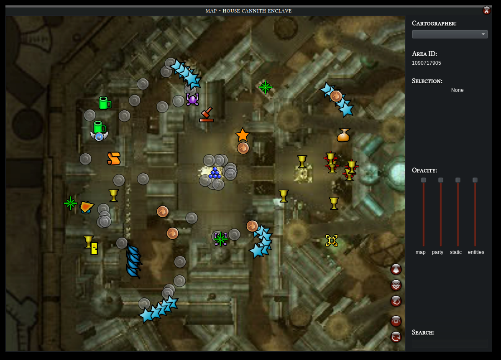
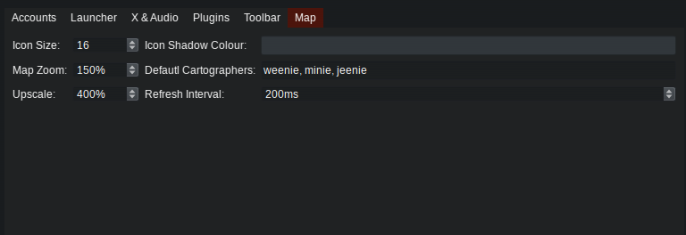

# Map

This is the module from μDDO to display the current map without the Fog of War, including most functionalities from Dungeon Helper's "Mapster".

I tried to replicate as closely as possible the behaviour of the original map. This included me re-drawing, one by one, each single map pin from the game and trying to match them in size and colours.

Some of the missing things
 - distinguishing completed from ongoing quests, which quests rewards exist
 - distinguishing from owned and not owned quests
 - some pin types are quite obscure and I could not find how to deduce the correct image to use from the game data
 - some pins will appear as duplicate because of the way I'm overlapping static pins and entity pins (more about that later)
 - it may show more static pins than you'd normally see with strange names (e.g. (Non-Localized) Trap)

### Main Features:
 - ctrl+Scroll: zoom in and out
 - drag map area: it drags the map area...
 - resize the panel at your leisure without crashing anything
 - click a map pin to select the object (and view more debugging details about it on the side menu, see below)
 - control opacity of the map, the players, the static and entity pins (more about those later)
 - search map pins by their name; accepts glob (e.g. "guard*" matches every pin whose name start with "guard"). Always case-insensitive.

### Buttons
On the bottom-right of the map panel you'll find the following buttons (red orbs):
 - center on the main player
 - center on selected target
 - select (in game) selected target. E.g. you selected a pin on the map, started a fight and pressed "tab" to target an enemy. Your pin selection is still retained in the map. Press this button to select the object associated with the selected map pin.
 - show/hide the side panel
 - refresh map pins. Ctrl+click: refresh the whole daemon

### Cartographer
This is the player who will effectively call the map daemon via Milvian. It will also be the central player. There can be only one cartographer. You can select the cartographer:
 - from the side panel, top-right (click the "eye" icon in bottom right of the screen if the side panel is not visible).
 - from Setup->Map->Default Cartographers: set a comma-separated list of character names that should be the cartographers by default. 

### Setup 
There are also a couple of options in the setup UI for Map (besides the Default Cartographers, already mentioned).

They are probably self-explanatory, except for Upscale: it upscales everything by this factor and then scales them down. For instance, in this example all icons will be loaded with a dimension equal to 4x of the icon size, so 4x16=64px. The background is also scaled up by 4 and then the default scene will zoom out to match 150% of the original image.

Though this may sound mystical, the reason is simple: with this setup, if you zoom in the map up to 4x, all icons will still remain crisp and fullres. Zooming in past 4x will cause jagged and blurry map pins. 

### Static vs Entity Pins
Static pins are "part of the game data" as provided by the raw .dat files. All in-game map pins are those static types. They just change slightly e.g. change colour if you completed a quest or so. 

Entity pins are extra. Those are actual game entities like enemies, traps and breakables. I added some convenience stuff too like soul binder, differentiate between rest and ressurrection shrine, etc.

You'll be able to see reapers, orange and red-named bosses, crests, chests and etc. If you feel like this is cheating, you can hide entity pins by setting their opacity to zero.

I currently do not support toggling specific pins on/off but if you want to do that, there is a trick. All images are in `μddo/images/ui_elements/map`. Setting an image to fully transparent will make that pin disappear. You can also copy `pin_enemy.png` over to `pin_boss_reaper.png` to make all reapers appear as regular enemies, for instance.

One of the drawbacks of enabling entity pins is that they sometimes will duplicate static pins. Usually they SHOULD overlap perfectly so you wouldn't see two of them, but that is not always what happens. I might be able to workaround that in the future.