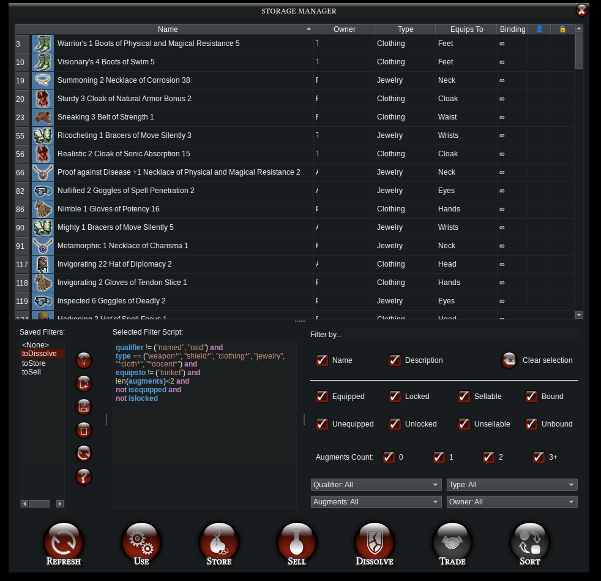

# Storage

Yet another cool μDDO feature relying on **Dungeon Helper+Milvian** framework. This is a quality of life (QoL) feature that includes batch dissolving, selling, storing and using items.

This whole module works by simulating mouse clicks and drags, which means that, while it is doing its thing, all you can do is watch the screen or try to fight it, if you have nothing better to do.



> ⚠️ **it is difficult (some would say, impossible, even)** to drag something from one UI into another (e.g. from inventory into the bank), if they are ATOP of each other. This module tries to detect overlaps between UIs and move them away from each other. It tries to guess which UI to move and then drag it by its top left corner. If the top left corner is covered, guess what happens? Yes, nonsense. Be a doll and keep your UI away from each other.

> ⚠️ **everything here** will require you to open some shop, bank or other UI manually. It will NOT try to guess it, even if it is within range. That is because I'm assuming you're using the Strategy and Macro modules. With Strategy, all your characters will follow the captain (including object selection) and with Macro you can set a hotkey for the absolutely revolutionary 'all: interact'.

## Loading/Refreshing
Because **Milvian** is designed to be lightweight and not intrusive, it does **not** automatically gather inventory data, ever, from anything. To do that, you need to explicitly "refresh" inventory data.

There are two options for that:
 - **"Quick" Refresh - Left Click**: just gets whatever information the client currently has about items in the inventory. This will return "something" for all items, though names might be vague, like "arrow" or "robe", enchantments/effects will not be listed, types might be incomplete, e.g. "armor" instead of "armor [medium]" or missing icons. This is normal. The local game client only has data about items that have been "examined", i.e. you hovered the item and it displayed all of its information.
 - **"Thorough" Refresh - Ctrl+Click**: goes item by item in your inventory and simulates an "examine" input. You will see the examination pop up going over all items while you do this. This will collect a lot more data about all items.

You can perform a thorough refresh after a quick refresh, and it should automagically replace all items by their more detailed version.

From now on, you can select any number of items from the table, re-sort it (click the column names), etc. You cannot drag-and-drop, drag operations simply select items from the table. Apart from that, all usual Qt bindings apply (`ctrl+click` toggles selection, `shift+click` selects a range, `ctrl+a` selects all, `esc` deselects all, etc).

`Right-click` the table to show a context menu with some few more options, including in-game selection, examining and refreshing data of selected items only.

You can also filter talbe items via UI (subframe to the bottom right) or filter scripts (subframe to the bottom left). You can even save filters that you use often (see [Filters](#filters---ui)), rename them and create file lists (e.g. list of scrolls to keep, list of filigrees to sell, see [Lists](#lists)).

> ⚠️ **This only reads items in a character's inventory**, not in its bank, containers such as bags or guild chests. There are plans to implement those, but definitely not any time soon.

## Storing
For this action to be performed, open a bank (personal or shared) or a guild chest (any). If both shared and personal bank are open, it will select shared bank.

Select all items you want to store from the table and click the big red button "Store" and that's it.

## Use
This action does not require any UI intervention (except for clicking a confirmation dialog). It uses the selected item (or equips them if that's a thing). `Ctrl+Click` to automatically accept potential confirmation dialogs. This also has keyboard shortcuts: press `Enter` to use all selected items, or `Ctrl+Enter` to use and confirm dialogues. Double-clicking on an item also uses it (but not all selected items).

## Selling
Open a vendor UI and select your items in μDDO. Left-click "Sell" and voila, it marks all selected items as junk and adds them to the cart.

Ctrl+Left Click also repairs all, sells gems and confirms the selling.

## Dissolving
Open deconstructor UI and select your items in μDDO. Click "Dissolve". That's it. Make sure you have enough dissolvents. There are no plans for supporting disjunction. 


## Filters - UI
Instead of manually inspecting each item and selecting them independently, you might want to filter items out by their properties. On the right side of the lower panel you have checkboxes and comboboxes with most of the meaningful things you may like to filter, e.g. by number of augments, by equipped/unequipped status, by bound/unbound status, by type, by owner, or even by name and description (accepts glob).

Those are additive filters, i.e. the table only shows items satisfying ALL criteria.


## Filters - Script
A more flexible way of filtering is by writing your own filter script. Click the "+" sign to add a new filter and edit its name in-place in the list. Filters are always saved as `$HOME/.config/muDDO/filters/<filter name>.filter` so don't use strange characters in your filter's name.

Filter scripts have the same features of the UI Filters & more. The syntax is simply `<criterion1> AND|OR <criterion2> AND|OR ... AND|OR <criterionN>`. Everything is case insensitive.

You may group by parenthesis, e.g. `(critA and critB) or (critC and critD)`. These are 3 basic types of criteria:

  - filter=<μString>: μStrings are a powerful module in μDDO which enable simple syntax for string comparison. It accepts glob, e.g. `name=*sword` matches anything ending with the word "sword". Also accepts tuples, e.g. `name=(*sword, potion of*)` matches anything ending with "sword" or starting with "potion of". It is case-insensitive.
  - filter<>!=<numeric>: for numbers, it accepts all the usual comparisons like ">", "<=", "==" etc
  - bool or !bool: if bool is enabled or not enabled.
  
| type | valid filters | 
| --- | --- | 
| μString   |  name, description, owner, type, equipsto, augments|
| numerical |  nAugs |
| bool      | isEquipped, isBound, isLocked | 

### Lists
All μString filters also support the "infile(<listname>)" command. This command reads the referred file (which should be named `$HOME/.config/muDDO/filters/<filter name>.list`) line by line and then builds a tuple with it. Example:

> You have a file named `$HOME/.config/muDDO/filters/preciousscrolls.list` containing
```
scroll1
scrollT
scroll of awesome *
*asty scroll
```
> The filter "name=infile(preciousscroll)" resolves to "name=(scroll1,scrollT,scroll of awesome *,*asty scroll)"


## About Trove
Currently I do not support saving storage data (like Trove plugin does) because even with Trove plugin, it gets messy really quickly (items may get duplicated when you share it via shared bank, or a trade does not get registered properly, etc). Also, μDDO and Milvian **need to be lightweight**. That's non-negotiable. It is maybe possible to track inventory smartly in a lightweight manner, but I have other priorities right now. 

## About Auction House Support
I may add auction house support in the future (i.e. batch-adding items to sell, auto-detecting prices based on current values, etc). However, I will NEVER implement a bot to outbid other people automatically. That'd be close to cheating, not QoL.
