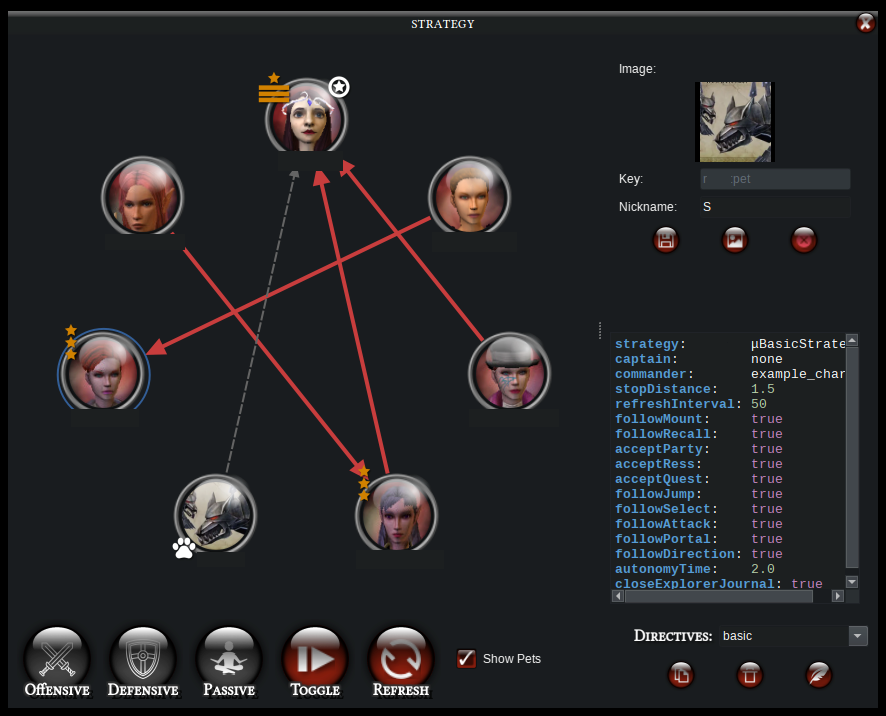

# Strategy

This is the module from μDDO that allows complex strategies to be defined, including most functionalities of Dungeon Helper's "Awesome Auto Follower" (AAF).

It can already be used via Macros via `strategy()` command. There is an UI  but it cannot possibly expose all the flexibility of the `strategy()`, so you might as well learn how to use it too. If you just want the UI stuff, skip to the last section.

Like most of the cool features of μDDO, this depends on **DungeonHelper + Milvian**. 

All "directives" (or rather, strategy configuration file) are stored as `.directives` files at `${HOME}/.config/muDDO/strategy/`. They are all in YAML format and as of now, must be manually configured. At least one directive must be present and they just acts as defaults and fallbacks. 

## Directives File
---------------------------------
Strategy files live in `${HOME}/.config/muDDO/strategy/` with a `.directives` extension. They are plain YAML:

```YAML
{
  "directives":        "μDefaultStrategy",
  "captain":           "leader",
  "commander":         "leader",
  "stopDistance":      1.5,
  "refreshInterval":   50,
  "followMount":       true,
  "followRecall":      true,
  "followJump":        true,
  "followSelect":      true,
  "followAttack":      true,
  "followPortal":      true,
  "followDirection":   true,
  "autonomyTime":      0.0,
  "acceptParty":       true,
  "acceptRess":        true,
  "acceptQuest":       true,
  "closeExplorerJournal": true
}
```
If one does not exist, please copy-paste this into the folder `${HOME}/.config/muDDO/strategy/` with the `.directives` extension for now. 

Missing keys in the file fall back to the defaults shown above. The `directives` field identifies which C# strategy class to instantiate — currently only `μDefaultStrategy` exists.

## Directives Reference
---------------------------------

### Party Roles

| Key | Type | Default | Description |
|---|---|---|---|
| `captain` | string | `"leader"` | Character this character physically follows (movement, jump, ladder, target selection). |
| `commander` | string | `"leader"` | Character whose recall/portal events this character mirrors. Usually same as captain. |

**captain** and **commander** are distinct. Captain is whoever is being effectively followed. Commanders give upper level orders - recall, enter portal, etc. They may be assigned to the same character. 

An important distinction is that a Commander MUST be a character running in the local machine - not a player in another computer. If none exists, then nobody can be a commander. Captains also MUST be running in the local machine but the runtime checks for that. If they are not local characters they are demoted to Sergeant. 

Sergeants have many of the same functionalities as Captains, e.g. you can follow them. But some restrictions exist. You cannot follow them into quest portals, recall or select the same target they are selecting. 

Special values:

| Value | Meaning |
|---|---|
| `"leader"` | Party leader. Resolved at call time, not updated if leader changes |
| `"none"` | Disables following entirely for that role. |
| `"self"` | Resolves to the character's own name at runtime. Useful in `all:` macros. |
| `"focus"` | Resolves to the character name of the currently focused game instance |
| `"name"` | Match by first name (case-insensitive, glob-enabled). |
| `"commander"` | Copies from current commander |
| `"captain"` | Copies from current captain |

You cannot explicitly set a sergeant. Set a captain instead and if it is non-local, it will fallback to sergeant.

### Movement

| Key | Type | Default | Description |
|---|---|---|---|
| `stopDistance` | float | `1.5` | Distance (game units) at which the character stops approaching the captain. Effective range: ~1.0–3.0 for staying close. |
| `refreshInterval` | int (ms) | `50` | Loop tick rate in milliseconds. Lower = more responsive, higher = less CPU consumption. |
| `autonomyTime` | float (sec) | `0.0` | Useful to allow player to control characters without breaking the following behaviour. After you send any kind of input to a game client, that client will stop following for `autonomyTime` seconds, allowing you to play with the character normally. Following is resumed after `autonomyTime` seconds of no inputs. Note: Milvian macros do NOT count as input|

### Follow Flags

| Key | Type | Default | Description |
|---|---|---|---|
| `followRecall` | bool | `true` | Trigger recall when *commander* recalls. |
| `followPortal` | bool | `true` | Enter portal when *commander* enters one. |
| `followJump` | bool | `true` | Jump when captain or sergeant jumps. |
| `followSelect` | bool | `true` | Mirror captain's target selection. |
| `followDirection` | bool | `true` | Face the same direction as the captain or sergeant when not moving. |
| `followAttack` | bool | `true` | Mirror attack state. ⚠️ WIP|
| `followMount` | bool | `true` | Mirror captain's mount action. ⚠️ WIP|

### Accept Flags

| Key | Type | Default | Description |
|---|---|---|---|
| `acceptParty` | bool | `true` | Auto-accept party invitations (from anyone). |
| `acceptRess` | bool | `true` | Auto-accept resurrection offers (from anyone). |
| `acceptQuest` | bool | `true` | Auto-accept quest share dialogs (from anyone). |
| `closeExplorerJournal` | bool | `true` | Auto-close the Explorer Journal popup. ⚠️ WIP|


## The strategy() Command
---------------------------------
Can be configured in the Macros Panel just like any other command. Can be bound to a shortcut as well.  Syntax:

```
strategy(<directives>, [action], [state], [key=value, ...])
```

| Token | Meaning |
|---|---|
| `<directives>` | Name of the `.directive` file (without extension), or an absolute path. Can be provided as `<basename>` if it is THE FIRST ARGUMENT; Otherwise, it can be provided as `directive=<basename>`|
| `action` | `set` or `toggle` — determines if this command will set flags or toggle flags. May be passed as `action=value` or just the plain value. If absent, `toggle` is selected. |
| `state` | `resume` or `pause` — explicit lifecycle control. Optional. May be passed as `state=value` or just the plain value|
| `key=value` | Any directive override, applied on top of the file. Important: `value` here can be an int, a float, a boolean or a string. It can also be given as `value1\|value2\|...\|valueN`. The meaning is explained in the next section |
| `bool` and `!bool` | Boolean directives, like "followRecall", may be given as a keyword without value. The meaning is explained in the next section |

> **⚠️ There is no validation mechanism**. For anything, as a matter of fact.

As this will be used in a macro, this has to follow all of the usual syntax:

```
<target>: strategy(<directives>, ...)
all: strategy(basic, toggle, followDirection)
john: strategy(basic, set, captain=mary)
```

## Actions: `set` vs `toggle`
---------------------------------

### set — Explicit assignment

Simply sets the value of a flag, regardless of what it was before:

```
all: strategy(basic, set, captain=john)
# → captain becomes "john" for all characters

all: strategy(basic, set, followDirection=false)
# → followDirection becomes false for all characters
```

It is idempotent — calling it again always lands on the same value. Booleans can be simplified here. For `action=set`, `followDirection=true` is the same as `followDirection` and `followDirection=false` is the same as `!followDirection`.

For integers, floats and strings, the values may have been passed as flattened lists `value1|value2|...|valueN`. In this case, set will use  **first value** only and ignore all the others.

### toggle — Cycle through values

Advances each overridden directive from its **current runtime value** to the next in the flattened list `value1|value2|...|valueN`. 
This works by finding the current value in the list and then setting it to the next one (wraps around when it reaches the end of the list).  When the current value is not in the list (e.g. fresh load), starts from the first.

For integers, floats or strings, the runtime ALWAYS creates a list to walk on. If the user passed just one value, a second one is taken from the **directives file**. Booleans are simpler, since they are just flipped.

```
all: strategy(basic, toggle, followDirection)
# → cycles: true → false → true → ...
# (bool with no value: appends file default as second option)

all: strategy(basic, toggle, captain=john|none)
# → cycles: current → "john" → "none" → "john" → ...
```

For toggling, only the current value of a boolean is relevant. Therefore, `followDirection=true` is the same as `followDirection`, `followDirection=false` and `!followDirection`. There is a small caveat when the boolean was never set before, that causes `followDirection=false` to flip opposite of the others, but that is a strange corner case. 


## State: `resume` and `pause`
---------------------------------

| Value | Effect |
|---|---|
| `resume` | Starts (or restarts) the follow loop. |
| `pause` | Stops the follow loop; character stands still. |

```
all: strategy(basic, set, state=resume)   # always ensure running
all: strategy(basic, set, state=pause)    # always ensure stopped
all: strategy(basic, toggle, state)       # if running → pause; if paused → resume
```

**Auto-launch behaviour:** if no `state` is provided but a directive changed, the strategy automatically re-launches to apply the new settings. If nothing changed and no state is provided, the call is a no-op (preserves current running state).

## Examples
---------------------------------

### Load strategy and start following
```
all: strategy(basic, resume)
```
All characters load `basic.directives` and start the follow loop.

### Stop all characters
```
all: strategy(basic, pause)
```

### Toggle follow on/off with one key
```
all: strategy(basic, toggle, state)
```
First press → pause. Second press → resume.

### Toggle captain between focused account and nobody
```
all: strategy(basic, toggle, captain=focus|none)
```
`focus` resolves to the current client's character at call time. This has a very interesting behaviour.

> No captain is assigned. John has focus; triggering this macro causes John to become captain and all characters follow him.
> Right after, Mary has focus and triggers the macro too. The runtime compares current captain (john) against the list (mary|none) and doesn't find it there. Therefore, Mary is the new Captain and all characters (including John) follow Mary now.
> Mary triggers the Macro again, but she is still the captain. The runtime finds the position of the current captain in the list (mary|none) and selects the next one, which is none. Now there are no longer captains.

This is one of the most useful macros for multiaccounting, i.e. "all follow me now" which also causes everybody to stop following if triggered by the current captain.

### Set john as captain with lax stop distance
```
all: strategy(basic, set, captain=john, commander=john, stopDistance=5.0)
```

### Let john lead; followers mirror everything except target selection
```
all: strategy(basic, set,
    captain=john,
    commander=john,
    followSelect=false,
)
```

### Grant followers 3 seconds of autonomy after any input
```
all: strategy(basic, set, autonomyTime=3.0)
```
After any keypress, the follow loop is suppressed for 3 seconds.

### Multiple overrides in one call
```
all: strategy(basic, set,
    captain=john,
    stopDistance=1.5,
    followJump=true,
    followPortal=true,
    followRecall=true,
    acceptParty=true,
    autonomyTime=2.0,
)
```

### Final Fantasy Party
```
john: strategy(basic, set, captain=none);
mary: strategy(basic, set, captain=john, stopDistance=3.0);
alan: strategy(basic, set, captain=mary, stopDistance=3.0);
alice: strategy(basic, set, captain=alan, stopDistance=3.0);
bob: strategy(basic, set, captain=alice, stopDistance=3.0);
```

## The UI

The UI provides a quick way to do non-canonical things you may not want to assign a shortcut for, or to visualize if what your shortcuts are doing what you think they are (though you also have the logs for that). In the image below, I censored the names of the characters.



### Customizing your Party 
When opening the UI for the first time, all character frames will be empty, showing only a circular frame and a name. That is expected. The UI does not know the appearance of your character, you need to provide that yourself. Double-click one of the frames to open the panel to the top-right side. There you can edit the Nickname for this character and its image (it opens an image selection dialogue; it also allows you to paste from clipboard). 

The UI can display pets (but not summons) too since it is a weird but fun thing to tell a character to follow a pet. Notice that pets cannot follow anybody but their owners. 

### Assigning Arrows
An arrow shows who is the captain of a specific player. A player may have no captain too and cycles are allowed (e.g. A follows B, B follows A). This is fine and intentional, and quite handy because Milvian implements the autonomy time.

Assignments are as follow:
 - draw a rectangle on the board: select all nodes within the rectangle
 - drag and drop from node A to node B: player A follows player B
   - if multiple nodes are selected, all selected follow player B
 - drag and drop node A to the board: player A follows nobody
 - ctrl+click multiple nodes: select each clicked node

Pets always have a dashed grey line towards their owner and their arrow cannot be changed. There is an option to hide pets if you find them unnecessary.

### Decorations - Party Member role
The role of the characters is also displayed on the frame, via a yellow insignia to the top-left of the circular frame. Those are set automatically according to that character's role.
 - a star with three horizontal lines: commander & captain
 - three horizontal lines with a loop: commander
 - three stars: captain
 - three chevrons: sergeant

Additionally:
 - pawns on the bottom-left: pet
 - cloud on the bottom left: non-local player
 - circled star on the top-right: party leader
 
 ### Actions
 Currently there are only 2 implemented actions out of 5 planned. 
  - Refresh: re-check party members and update decorations accordingly.
  - Toggle: pause/resume all selected players. Non-local players and pets are ignored. If no player is selected, then targets all. 
  - Offensive, Defensive, Passive: TODO

 ### Directives Editor:
 You can also conveniently change your directives right in the panel. On the bottom-right there is a combo box with all existing directives, plus buttons for duplicating, deleting and editing them. Clicking the edit button opens up the textbox with a syntax highlighter. 